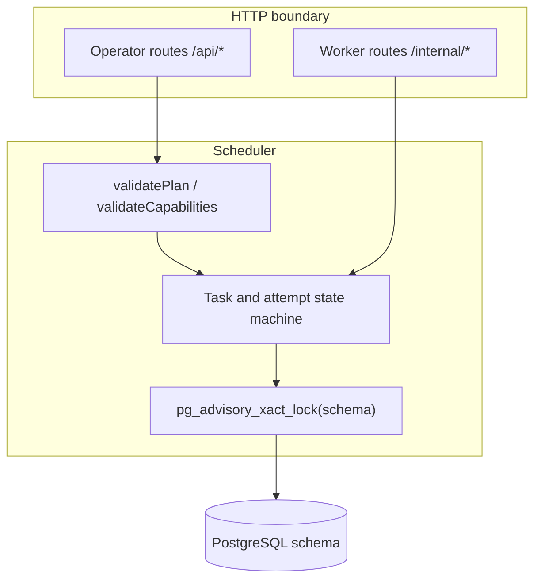
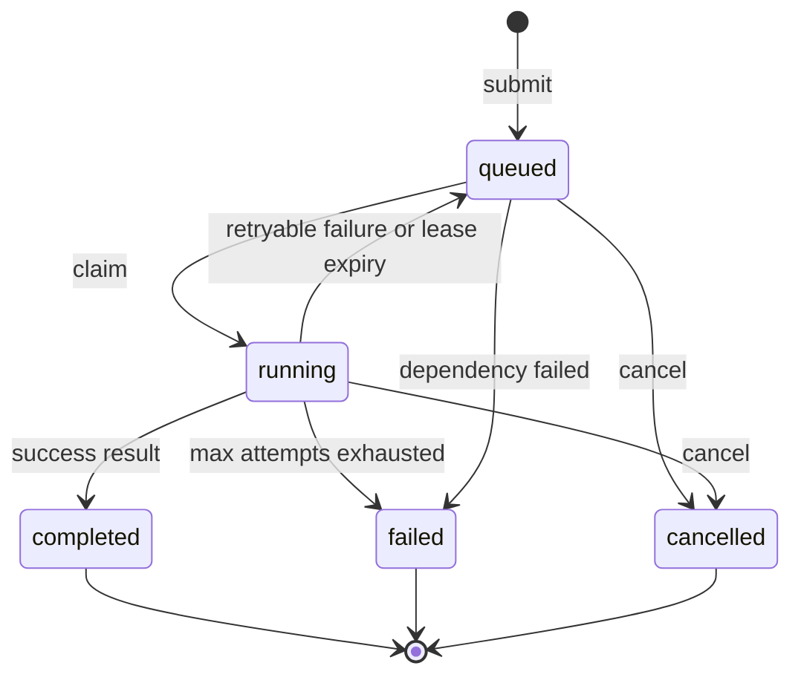
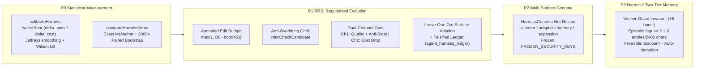

# Architecture and design

## Layers

The framework has four layers:

1. **Catalog** — a deployment-owned list of capability names and descriptions. Registration accepts only catalog entries. Business code decides how a capability is implemented.
2. **Scheduler** — PostgreSQL is the source of truth for workers, tasks, attempts, events, quotas, and shared facts. Every mutation runs in a short transaction protected by a per-schema advisory lock.
3. **Worker boundary** — a worker authenticates with a credential scoped to one capability. It registers before claiming, renews its lease while running, and returns results with its `call_id`.
4. **Domain adapter** — the handler reads task input and dependency facts, calls real systems, and applies its own authorization, idempotency, and audit policy.

Do not fork the scheduler to store business records. Keep domain data in its own schema and put identifiers in task input.

## Lifecycle

Normal path: `register → claim → heartbeat → result`.

A claim creates an attempt and binds the task to `agent_id`, `attempt_id`, and `call_id`. The scheduler accepts a result only while those bindings still describe the current running attempt.

Cancellation marks the **task** cancelled immediately, but keeps the running attempt and its execution slot until the worker acknowledges stop or the lease expires. Lease expiry finishes the attempt and releases the slot. Both paths reject late receipts so they cannot overwrite newer state.

`tick()` (the CLI runs it every second) reclaims expired attempts **before** deleting stale registrations. Worker rows older than one hour with no running attempt are removed.

One reap transaction propagates dependency failure to all affected queued descendants, including converging branches, with one `dependency_failed` event per task. Independent branches are unaffected. Workers check cancellation and deadlines before invoking handlers. Transport failure while reporting success is not converted into a handler failure: the run loop re-registers and retains lease-based recovery. External effects still require domain idempotency.

## Task graphs

Clients submit a `request_id` and a JSON plan `{ tasks: [...] }`.

Before any write, the scheduler:

1. Detaches caller objects with a JSON round-trip.
2. Sorts tasks and dependency lists for deterministic comparison.
3. Rejects duplicate local ids, unknown dependencies, and cycles.
4. Checks each capability against the catalog in the same transaction as the first insert.

Repeating the same `request_id` with the same normalized graph is idempotent and returns the existing database task ids. Changing the graph under the same id is rejected (`Idempotency conflict`).

Constraints enforced in code:

| Rule              | Limit                                    |
| ----------------- | ---------------------------------------- |
| Tasks per request | 1-100                                    |
| Local task id     | `[\w-]{1,80}`                            |
| Request id        | `[\w-]{8,80}`                            |
| Capability name   | `^[a-z][a-z0-9_.-]{0,63}$`               |
| Input             | JSON object, serialized length ≤ 100_000 |
| Worker id         | `[\w-]{4,100}`                           |
| Schema name       | `^[a-z][a-z0-9_]{0,62}$`                 |

## Data model

All tables live in the configured schema. `scheduler.init()` creates the schema and applies [src/scheduler.sql](../src/scheduler.sql).

| Table                  | Purpose                                                                                             |
| ---------------------- | --------------------------------------------------------------------------------------------------- |
| `agent_capabilities`   | Catalog of allowed capabilities (with input/output contracts, memory prefix sandboxes & `verifier`) |
| `agent_requests`       | Idempotent request id to normalized plan, FinOps token/cost budgets & usage, and `trace_id`         |
| `agent_expansions`     | Idempotent runtime subgraph expansions per `(request_id, expansion_id)`                             |
| `agent_tasks`          | Durable tasks, status, dependencies, priority, reputation/confidence gates, `fact_key`, `context_*` |
| `agent_attempts`       | One leased attempt per claim, fenced by `call_id`, recording token/cost `usage`                     |
| `agent_workers`        | Registered instances, lease, enabled flag, in-flight, consecutive failures                          |
| `agent_events`         | Immutable operational audit event log                                                               |
| `shared_facts`         | Versioned outputs of successful tasks, verdicts, `confidence`, `fact_key`, and `expires_at`         |
| `agent_triggers`       | Cron expression, fixed-interval, and webhook trigger definitions and execution counters             |
| `agent_playbooks`      | Crystallized organizational skill templates (Procedural Memory SOPs), versions, and run counters    |
| `agent_harness_genome` | Multi-surface evolvable genome (`planner_prompts`, `adapter_prompts`, `memory_config`, `expansion`) |
| `agent_harness_ledger` | Append-only RRSI evolution & falsified hypothesis ledger (surfaces, verdicts, ablation details)     |
| `agent_quota`          | Global `execution` capacity                                                                         |

Task status values: `queued`, `running`, `completed`, `failed`, `cancelled`.

Attempt status values: `running`, `completed`, `failed`.

Recorded events include `queued`, `registered`, `dispatched`, `completed`, `attempt_failed`, `cancelled`, `late_result_rejected`, `dependency_failed`, `fact_reviewed`, `rework_triggered`, `worker_isolated`, `subgraph_expanded`, `budget_exceeded`, `trigger_upserted`, `trigger_fired`, `fact_rolled_back`, `request_forked`, `playbook_crystallized`, `playbook_executed`, and `bundle_imported`.

Shared facts initially store `verified: false`. Execution success does not imply verification. Operators use `reviewFact` (or independent Verifier Workers with `verifier: true` use `reviewFactByVerifier`, with self-review forbidden) to review an exact output version with a confidence score, note, and timestamp; the same transaction appends a `fact_reviewed` event.

With `require_verified_facts: true`, a task can only be claimed after all direct dependencies complete and their current output versions are verified (and satisfy `min_fact_confidence`). Pending or revoked reviews leave the task queued without consuming attempts or quota; operators may review again or cancel it. When rejecting a fact (`verified: false`) with `rework: true` (provided no dependent task has already been dispatched or completed), the scheduler either re-queues the task—attaching `prior_facts` with review notes on the next claim—or marks it `failed` and propagates failure if `max_attempts` is exhausted.

In addition, the scheduler provides four symbiotic organizational coordination primitives:

1. **Capability telemetry, circuit-breaking & reputation-gated dispatch (`telemetry` / `maxConsecutiveFailures` / `min_worker_pass_rate`)** — tracks consecutive worker failures and rejected facts, automatically isolating a worker (`enabled = false` with a `worker_isolated` event) at the configured threshold, and enforces `min_worker_pass_rate` on high-stakes tasks (with cold-start protection for unreviewed workers).
2. **Bounded dynamic subgraph expansion & time-travel DAG branching (`expand` / `forkRequest`)** — idempotently attaches a validated sub-DAG under a running or completed `parent_task_id` (optionally rewiring queued dependents via `rewireDependents`), and supports branching any request from a target node via `forkRequest` while reusing upstream completed tasks and verified facts.
3. **Cross-request semantic memory, dynamic search & version rollback (`fact_key` / `context_keys` / `context_query` / `rollbackFact`)** — tasks publish outputs under a `fact_key` (with optional `fact_ttl_seconds`) and subscribe statically via `context_keys` or dynamically via `context_query`, with 1-click version rollback via `rollbackFact`.
4. **Procedural memory & skill crystallization (`crystallizePlaybook` / `runPlaybook`)** — distills proven request graphs (including runtime `expand` subgraphs) into versioned, reusable Organizational Playbooks (SOPs), included in `exportBundle` / `importBundle`.

Review and claim share the schema transaction lock. Claimed facts include review notes and timestamps. Revocation only affects future claims; it cannot interrupt or roll back dispatched tasks or external effects.

Inspired by the supplied book's action–feedback–accumulation cycle, these primitives ground auditable feedback, iterative rework, dynamic coordination, time-travel branching, and three-tier organizational memory (episodic events, semantic facts, and procedural playbooks) in PostgreSQL transactions.

Before upgrading, back up the database and stop old schedulers. Run `init()` to add columns with compatible defaults; migration is repeatable and does not rewrite old plans. Do not mix old schedulers with gated tasks because old code ignores the gate. Before rolling back, drain or cancel queued gated tasks; additive columns may remain.

## Concurrency and fencing

- One worker executes at most one running attempt.
- Global running attempts cannot exceed `capacity`.
- Claim order is `priority DESC, updated_at, task_id` among ready queued tasks of that capability.
- Result acceptance requires `attempt.status = running`, `task.status = running`, and `task.call_id = call_id`.
- A result posted with another worker's capability or a stale `call_id` is not accepted.
- Failed attempts retry while `attempts < max_attempts` (the configured value includes the first try).
- If a queued task depends on a missing, failed, or cancelled predecessor, `tick()` marks it `failed` with `dependency_failed`.

## Trust boundaries

| Actor          | Credential                | Can do                                                                                               |
| -------------- | ------------------------- | ---------------------------------------------------------------------------------------------------- |
| Operator       | `REGISTRY_OPERATOR_TOKEN` | Submit, plan, fork, cancel, review/rollback facts, manage triggers/playbooks/bundles, manage workers |
| Worker cohort  | per-capability token      | Register, claim, heartbeat, and result **only** for that capability (`verifier` can review others)   |
| Domain handler | none from this framework  | Must authorize every side effect itself                                                              |

A capability token defines a trusted cohort. It does not isolate mutually hostile processes that share the token. Use a unique `agent_id` per process.

Credentials must be random, stored outside the repository, rotated by the deployment, and never placed in task input. The HTTP layer returns stable error categories and does not expose driver messages, connection strings, or payloads.

## Recovery and operations

Graph submission batches tasks and audit events in SQL. Dependency failure propagation batches updates and events too. A 100-task submission uses 4 business queries inside the transaction; cancelling its root with 99 queued descendants uses 5 when no attempts expire (excluding BEGIN, lock acquisition, and COMMIT). `test/performance.integration.test.mjs` checks query budgets, dependency mapping, idempotency, and audit completeness. Timing is diagnostic, not a cross-machine performance guarantee.

Claim quota checks aggregate inside PostgreSQL and return only counts and worker occupancy. Indexes cover queued capability priority ordering, request retries, recent tasks, running workers, named facts, and due triggers. `init()` creates these indexes; schedule a maintenance window for large existing tables because ordinary CREATE INDEX blocks writes. The schema transaction lock remains a throughput limit; fewer round trips do not imply unlimited horizontal scaling.

Leases make process loss recoverable. Keep PostgreSQL backups. Monitor:

- `agent_events`
- failed attempts and `last_error`
- queue age (`queued` tasks' `updated_at`)
- lease-expiry rate
- handler latency versus `deadline`

Run each deployment with an isolated schema and a least-privilege database role. Configure every scheduler process identically: catalog, lease, deadline, capacity, and `maxAttempts`. Catalog initialization inserts or updates names; it does not delete historical capabilities.

## Self-Evolving Harness Regularization & Two-Tier Memory (Google RRSI / ReSelf & Harness²)

Aligned with Google RRSI (`google-research/rrsi`, Regularized Recursive Self-Improvement) and Harness² (`arXiv:2610.14224`, Multi-Surface Self-Evolving Agent Harness), the kernel enforces four layers of self-evolution governance ([`src/harness.mjs`](../src/harness.mjs)):

1. **P0 Noise-Calibrated & Paired Cost-per-Verified Evaluation**:
   - `calibrateHarness` computes single-arm noise floors ($\delta_{\text{pass}}$ via Jeffreys smoothed Bernoulli variance $p_i = (k_i + 0.5)/(n_i + 1)$ and $\delta_{\text{cost}}$ via sample variance);
   - `compareHarnessArms` runs an exact McNemar test and a 2000-iteration seeded paired bootstrap 95% CI on the primary `cost_per_resolved` ratio ($B / A$) alongside a non-inferiority guard ($B - A \ge -\delta$).
2. **P1 RRSI Regularization for Genome, Subgraph & Playbook Evolution**:
   - **Surface-Level Annealed Edit Budget**: `changedGenomeSurfaces` / `changedGenomeLines` and runtime `expand` enforce per-round annealed edit limits ($\max(1, B_0 - \lfloor r / 2 \rfloor)$);
   - **Anti-Overfitting Critic (`criticCheckCandidate`)**: blocks candidates that hardcode evaluation task IDs, `check.py`, `_check.py`, `hidden_test`, or verification bypass markers;
   - **Falsified Ledger & Stagnation Redirection**: `agent_harness_ledger` records every mutation's target surfaces, hypothesis, metrics, and verdict, injects falsified history into `Planner`, and redirects stagnant searches via `pickStagnationSurface`;
   - **Dual-Channel Cost-Aware Gate & Ablation Pruning**: `evolveGenome` / `evolvePlaybook` promote candidates via either Channel 1 (quality gain $> \delta_{\text{pass}}$ within `maxTokenGrowth`) or Channel 2 (non-inferior pass rate with token savings $\ge \delta_{\text{tokens}}$), and prune zero-benefit free-rider surfaces.
3. **P2 Multi-Surface `HarnessGenome` with Frozen Security Boundaries**:
   - `agent_harness_genome` governs `planner_prompts`, `adapter_prompts`, `memory_config`, and `expansion_config` while strictly freezing verification gates, self-review prevention, prefix ACLs, and lease fencing, with a 100% byte-identical no-op default when empty (`{}`).
4. **P3 Harness² Two-Tier Memory (`invariant` vs `episodic`) & Cost-Aware Attribution**:
   - **Verifier-Gated Promotion & Episodic Capping**: triggered strictly after `verified = true` review when a module namespace (e.g., `org.policy.*`) accumulates `>= 2` distinct verified episodic facts, synthesizing `[Module Invariant: <namespace>]` (`fact_key = "<namespace>.__invariant__"`) while preserving its `injected_count` / `accepted_count` Beta posterior weights across in-place updates and capping active episodic facts in that namespace to `max_episodic_per_namespace = 2`;
   - **Priority Recall & High-Cost Turn Free-Rider Discounting**: invariants receive a `+6` structural score boost under a `6 entries / 2400 chars` recall cap; on expensive turns (`total_tokens > expensive_token_threshold`), only domain-relevant recalled facts receive `accepted_count + 1`, while unrelated free-rider facts only increment `injected_count`.

## Extension contract

Add a capability entry, implement a handler (or use `createLlmWorkerHandler` / `createMcpWorkerHandler`), and submit a graph via JSON, the natural-language `Planner`, a scheduled `Trigger`, or a crystallized `Playbook`.

If a different transport is required, map it onto the same scheduler methods and preserve `agent_id`, `attempt_id`, `call_id` semantics. Do not treat this HTTP API as a high-throughput horizontally scaled bus: writes serialize per schema on purpose. `examples/workflow.mjs` and `examples/ui-demo.mjs` are deterministic and need no external model key.
