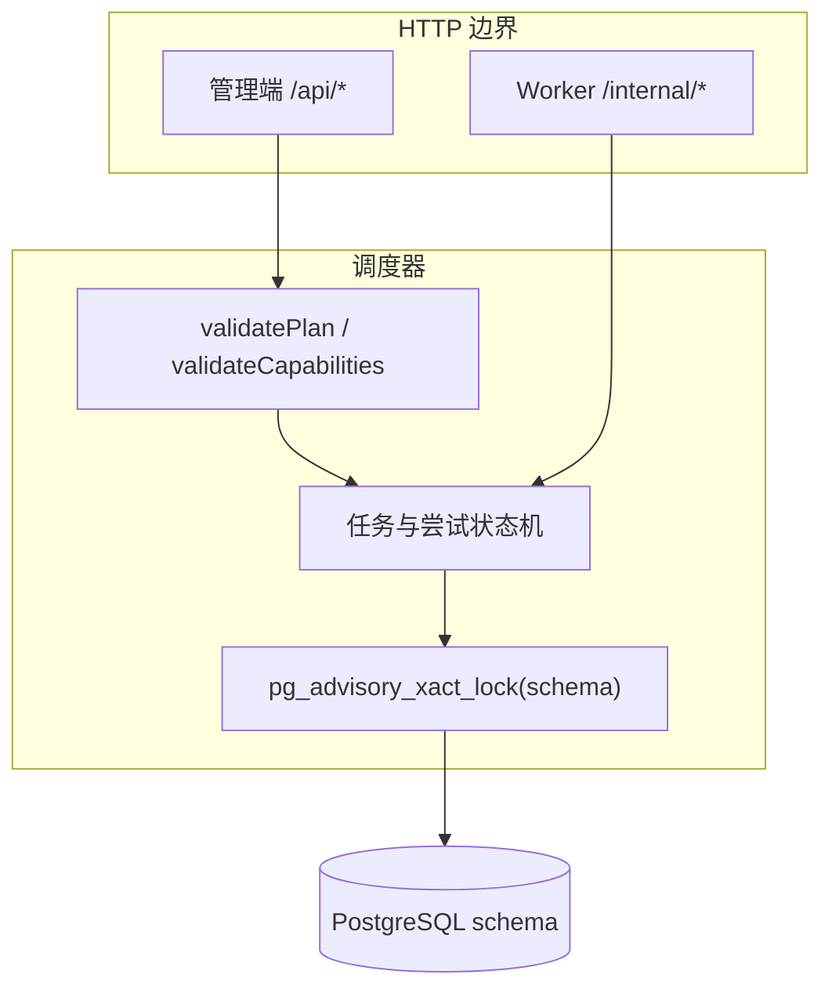
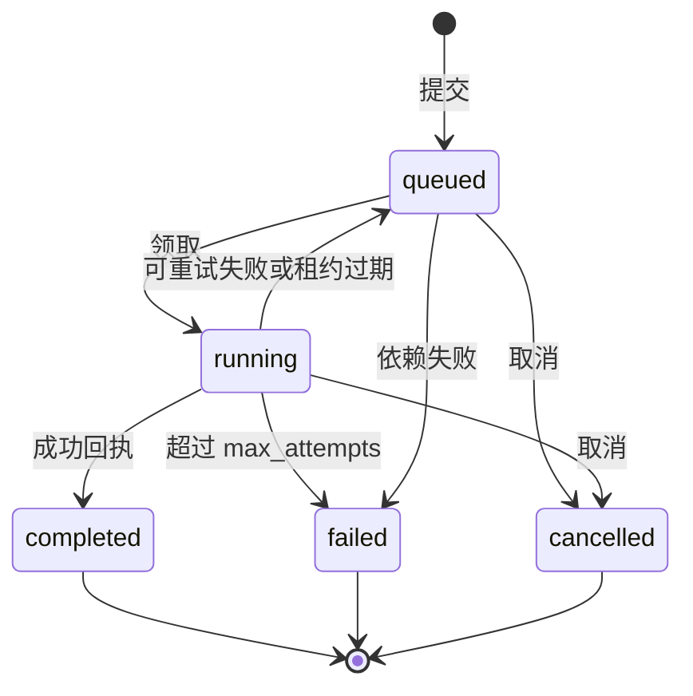
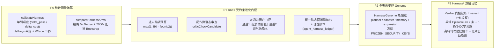

# 架构与设计

## 分层

框架分为四层：

1. **能力目录**：部署方维护能力名称和说明。只有目录中的能力可以注册；如何实现由业务代码决定。
2. **调度器**：PostgreSQL 是 Worker、任务、尝试、事件、配额和共享事实的事实源。每次状态变更使用短事务，并按 schema 加 advisory lock。
3. **Worker 边界**：凭据只绑定一个能力。先注册再领取，执行中续租，用 `call_id` 回传结果。
4. **业务适配层**：处理函数读取任务输入和依赖事实，访问真实系统，并自行负责鉴权、幂等和审计。

不要为了存业务记录去复制一份调度器。业务数据放在自己的 schema，任务输入只引用其标识。

## 生命周期

正常路径：`register → claim → heartbeat → result`。

领取会创建一次尝试，并把任务绑定到 `agent_id`、`attempt_id` 和 `call_id`。只有这些绑定仍指向当前运行中的尝试时，调度器才接受回执。

取消会立刻把**任务**标为 `cancelled`，但运行中的尝试和执行额度会保留到 Worker 确认停止或租约过期。租约过期会结束尝试并释放额度。两条路径都会拒绝迟到回执，避免覆盖新状态。

CLI 每秒调用一次 `tick()`：先回收过期尝试，再删除过期注册。超过一小时且没有运行中尝试的 Worker 行会被删除。

一次回收事务会将依赖失败传播到全部受影响的排队后代（包括多分支汇合），每个任务仅记录一次 `dependency_failed`；不影响独立分支。Worker 在调用处理函数前检查取消和截止时间。成功结果回传时的通信失败不会被改报为业务失败，而由运行循环重新注册，保留调度器的租约恢复语义；外部副作用仍需业务幂等。

## 任务图

客户端提交 `request_id` 和 JSON 计划 `{ tasks: [...] }`。

写入前调度器会：

1. 用 JSON 往返隔离调用方对象。
2. 对任务和依赖列表排序，保证比较是确定的。
3. 拒绝重复的请求内 ID、悬空依赖和循环。
4. 在第一次插入的同一事务里核对能力目录。

相同 `request_id` 且规范化后的任务图相同，属于幂等提交，返回已有数据库任务 ID。同一编号改图会被拒绝（`Idempotency conflict`）。

代码中的限制：

| 规则             | 限制                                   |
| ---------------- | -------------------------------------- |
| 每个请求的任务数 | 1-100                                  |
| 请求内任务 id    | `[\w-]{1,80}`                          |
| 请求编号         | `[\w-]{8,80}`                          |
| 能力名           | `^[a-z][a-z0-9_.-]{0,63}$`             |
| 输入             | JSON 对象，序列化后不超过 100_000 字符 |
| Worker id        | `[\w-]{4,100}`                         |
| schema 名        | `^[a-z][a-z0-9_]{0,62}$`               |

## 数据模型

全部表位于配置的 schema。`scheduler.init()` 创建 schema 并执行 [src/scheduler.sql](../src/scheduler.sql)。

| 表                     | 作用                                                                                            |
| ---------------------- | ----------------------------------------------------------------------------------------------- |
| `agent_capabilities`   | 允许注册的能力目录（含输入/输出契约、记忆前缀沙箱与 `verifier` 标记）                           |
| `agent_requests`       | 请求编号到规范化任务图、FinOps Token/成本预算与消耗、全链路 `trace_id`                          |
| `agent_expansions`     | 运行中按 `(request_id, expansion_id)` 幂等追加子图                                              |
| `agent_tasks`          | 任务、状态、依赖、优先级、声誉/置信度门禁、`fact_key`、`context_keys`、`context_query`          |
| `agent_attempts`       | 每次领取对应一次租约尝试，用 `call_id` 隔离，记录 Token/成本 `usage`                            |
| `agent_workers`        | 已注册实例、租约、启用标记、在途数、连续失败数                                                  |
| `agent_events`         | 全链路不可变审计运行事件                                                                        |
| `shared_facts`         | 成功任务的带版本输出、核验结论、置信度（`confidence`）、`fact_key` 与 `expires_at`              |
| `agent_triggers`       | Cron 表达式、固定秒级间隔与 Webhook 事件触发器状态表                                            |
| `agent_playbooks`      | 已结晶的组织技能模板（程序性记忆 SOP）、版本号、参数化任务图与复用统计                          |
| `agent_harness_genome` | 多表面自进化基因组（`planner_prompts`、`adapter_prompts`、`memory_config`、`expansion_config`） |
| `agent_harness_ledger` | RRSI 自进化实验与证伪假设追加写账本（记录候选表面、前后版本、门控原因與留一法消融明细）         |
| `agent_quota`          | 全局 `execution` 容量                                                                           |

任务状态：`queued`、`running`、`completed`、`failed`、`cancelled`。

尝试状态：`running`、`completed`、`failed`。

事件包括 `queued`、`registered`、`dispatched`、`completed`、`attempt_failed`、`cancelled`、`late_result_rejected`、`dependency_failed`、`fact_reviewed`、`rework_triggered`、`worker_isolated`、`subgraph_expanded`、`budget_exceeded`、`trigger_upserted`、`trigger_fired`、`fact_rolled_back`、`request_forked`、`playbook_crystallized`、`playbook_executed`、`bundle_imported`。

共享事实的 `verified` 初始为 `false`。执行成功不代表核验通过。管理端通过 `reviewFact`（或具备 `verifier: true` 权限的独立裁判 Worker 通过 `reviewFactByVerifier`，严禁自审）为确切输出版本记录核验结论、置信度、意见和时间，并在同一事务内追加 `fact_reviewed` 事件。

任务声明 `require_verified_facts: true` 时，必须等所有直接依赖完成且其当前输出版本已核验（并满足 `min_fact_confidence` 最低置信度），才能领取。未核验或撤回核验不会消耗任务尝试或配额；任务保持排队，管理端可重新核验或取消。当核验拒绝（`verified: false`）且显式指定 `rework: true`（并且尚无已派发或已完成的下游依赖任务）时，调度器可将任务重新入队（下一次领取时注入带 `review_note` 的 `prior_facts`），或在尝试耗尽时标为 `failed` 并级联通知下游。

此外，框架支持完整的共生组织演进原语：

1. **画像、熔断与声誉门禁路由（`telemetry` / `maxConsecutiveFailures` / `min_worker_pass_rate`）**：跟踪 Worker 连续执行失败与核验拒绝次数，达到阈值时自动隔离（`enabled = false` 并记录 `worker_isolated`）；高优任务可声明 `min_worker_pass_rate` 声誉门禁，仅允许历史核验通过率达标的 Worker（或尚无审阅记录的冷启动新 Worker）认领。
2. **受控动态子图扩展与时间旅行分叉（`expand` / `forkRequest`）**：支持在父任务运行或完成后按 `(request_id, expansion_id)` 幂等挂载子 DAG 并自动缝合下游（`rewireDependents`）；支持通过 `forkRequest` 从任意节点分叉创建新请求，零成本复用上游已完成节点与核验事实，仅重跑目标节点及其下游分支。
3. **跨请求语义记忆、动态检索与版本回滚（`fact_key` / `context_keys` / `context_query` / `rollbackFact`）**：任务可声明 `fact_key`（及 `fact_ttl_seconds`）发布版本化事实；后续任务可通过 `context_keys` 静态订阅或通过 `context_query` 动态关键词检索注入有效事实快照到 `task.context_facts`，并支持通过 `rollbackFact` 一键回退至上一已核验版本。
4. **程序性记忆与技能结晶（`crystallizePlaybook` / `runPlaybook`）**：将跑通的请求任务图（自动包含运行中动态扩展的子图拓扑）固化为可版本化复用的组织标准作业程序（Playbook / SOP），并支持纳入 `exportBundle` / `importBundle` 跨环境迁移。

核验与领取使用同一个 schema 事务锁，领取到的事实包含核验意见及时间。撤回核验只阻止后续领取，不中断或回滚已派发任务及外部副作用。

这将《智能》中“行动产生反馈、反馈形成积累”的思路落在可审计的输出版本、重做闭环、动态协同、时间旅行分叉与三层组织记忆（事件、语义事实、程序性技能结晶）上。

升级前备份数据库并停止旧调度进程，再运行 `init()` 添加带兼容默认值的列；可重复执行，无需重写旧计划。启用门禁后不要混跑旧调度器：旧代码不检查门禁。回退前应先排空或取消启用门禁的排队任务；新增列可保留。

## 并发与隔离

- 每个 Worker 同一时刻最多一个运行中尝试。
- 全局运行中尝试数不能超过 `capacity`。
- 领取顺序是该能力下已就绪排队任务的 `priority DESC, updated_at, task_id`。
- 接受回执要求 `attempt.status = running`、`task.status = running` 且 `task.call_id = call_id`。
- 用其他能力凭据或过期 `call_id` 回传不会被接受。
- 失败后仅当 `attempts < max_attempts` 时重新入队（配置值包含首次执行）。
- 排队任务的依赖缺失、失败或已取消时，`tick()` 将其标为 `failed`，错误为 `dependency_failed`。

## 信任边界

| 角色         | 凭据                      | 权限                                                                  |
| ------------ | ------------------------- | --------------------------------------------------------------------- |
| 管理端       | `REGISTRY_OPERATOR_TOKEN` | 提交、编排、分叉、取消、核验/回滚事实、管理触发器/技能模板、管理节点  |
| Worker 群组  | 按能力的 Token            | 只能对该能力做注册、领取、心跳、回执（`verifier` 能力可核验他人事实） |
| 业务处理函数 | 框架不发凭据              | 每次外部副作用前必须自行鉴权                                          |

同一能力 Token 代表互相信任的实例群，不隔离群内恶意进程。每个进程使用唯一 `agent_id`。

凭据必须随机生成、放在仓库之外、由部署方轮换，且不能放进任务输入。HTTP 层只返回稳定错误类别，不泄露驱动异常、连接串或任务内容。

## 恢复和运维

提交任务图使用批量 SQL，同时写入任务和对应事件；依赖失败传播也批量更新并写入事件。100 节点提交的事务内业务查询为 4 次，取消根节点并传播到 99 个排队后代为 5 次（无过期尝试，不含 BEGIN、锁和 COMMIT）。`test/performance.integration.test.mjs` 验证查询数量上限、依赖映射、幂等和事件完整性，避免逐节点数据库往返回归；耗时仅作诊断，不作为跨机器性能承诺。

领取配额在数据库内聚合，只返回计数和实例占用标记。索引覆盖排队任务的能力与优先级排序、请求重试查询、近期任务、运行中实例查询、命名事实与触发器到期扫描。`init()` 会创建新增索引；已有大表应安排维护窗口，普通 CREATE INDEX 会占用写锁。schema 事务锁仍是吞吐上限，以上优化减少往返，不代表已实现无限横向扩展。

租约让进程崩溃可以恢复。应备份 PostgreSQL，并监控：

- `agent_events`
- 失败尝试和 `last_error`
- 排队等待时间（`queued` 任务的 `updated_at`）
- 租约过期率
- 处理耗时是否接近 `deadline`

每个部署使用独立 schema 和最小权限数据库账号。多个调度进程的目录、租约、截止时间、容量和 `maxAttempts` 必须一致。初始化只插入或更新能力名，不删除历史能力。

## 自进化 Harness 正则化与双层记忆架构（Google RRSI / ReSelf & Harness²）

对照 Google RRSI（`google-research/rrsi`，正则化自进化搜索）与 Harness²（`arXiv:2610.14224`，多表面自进化智能体底座），框架在内核态内置了四层自进化治理约束（[`src/harness.mjs`](../src/harness.mjs)）：

1. **P0 噪声校准与「每核验通过事实成本 (`cost_per_verified_usd`)」配对评测**：
   - `calibrateHarness` 基于 Jeffreys 平滑伯努利参数 $p_i = (k_i + 0.5)/(n_i + 1)$ 计算单臂解决/核验噪声下限 $\delta_{\text{pass}}$ 与成本噪声下限 $\delta_{\text{cost}}$；
   - `compareHarnessArms` 提供精确 McNemar 检验与 2000 次固定种子按题配对 Bootstrap 95% 置信区间（检验主指标 `cost_per_resolved` 比值 $B / A$ 的显著性与解决率非劣效护栏 $B - A \ge -\delta$）。
2. **P1 进化搜索的 RRSI 正则化**：
   - **表面级退火编辑预算**：`changedGenomeSurfaces` / `changedGenomeLines` 及 `expand` 动态扩展均支持随轮次 $r$ 退火收紧的单步变更预算（$\max(1, B_0 - \lfloor r / 2 \rfloor)$）；
   - **反过拟合审查器（`criticCheckCandidate`）**：自动拦截在提示词或技能模板中硬编码测试任务 ID、`check.py`、`_check.py`、`hidden_test` 或跳过核验指令的候选；
   - **证伪假设账本与停滞转向**：`agent_harness_ledger` 记录每次进化尝试的目标表面、假设、指标与结论，自动向 `Planner` 注入最近被拒的证伪历史，并在连续停滞时通过 `pickStagnationSurface` 自动转向探索最少的表面；
   - **双通道成本感知验收门与消融剪枝**：`evolveGenome` / `evolvePlaybook` 支持「质量显著提升 + 防 Token 膨胀」或「非劣效同分显著降本」双通道晋级，并对多表面晋级候选执行逐面回滚消融剪枝（剔除零收益搭便车修改）。
3. **P2 受控多表面 `HarnessGenome` 与冻结安全边界**：
   - `agent_harness_genome` 统一管理 `planner_prompts`、`adapter_prompts`、`memory_config` 与 `expansion_config`，严禁触碰 `verifier` 门禁、防自审隔离、记忆前缀 ACL 与租约围栏等核心安全边界，且空配置 `{}` 保证 100% 字节级默认等价。
4. **P3 组织记忆的 Harness² 双层结构化（`invariant` vs `episodic`）与成本感知归因**：
   - **裁判后置晋升与情景封顶**：仅当外部管理端或独立 Verifier 核验通过（`verified = true`）且同一模块命名空间（如 `org.policy.*`）累计达到 `>= 2` 条不同情景事实时，自动合并提炼结构化模块不变量 `[Module Invariant: <namespace>]`（`fact_key = "<namespace>.__invariant__"`，原地更新时保留历史 `injected_count` / `accepted_count` Beta 权重），并将该模块名下的旧单题情景记忆自动裁剪至最多保留最新 `max_episodic_per_namespace = 2` 条；
   - **优先召回与高消耗搭便车打折**：模块不变量在检索中享有 `+6` 结构性加权，单次任务召回严格限制在 `6 条 / 2400 字符` 预算内；当任务属于高消耗轮次（`total_tokens > expensive_token_threshold`）时，仅与当前任务领域/键值命中的召回记忆获得 `accepted_count + 1`，未命中的搭便车记忆仅记 `injected_count + 1`，低效情景记忆自动降级淘汰。

## 扩展契约

增加目录项，实现处理函数（或使用 `createLlmWorkerHandler` / `createMcpWorkerHandler`），然后通过 JSON、自然语言 `Planner`、定时 `Trigger` 或已结晶的 `Playbook` 提交任务图。

若需要其他传输层，把它适配到相同的调度器方法，并保留 `agent_id`、`attempt_id`、`call_id` 语义。不要把这套 HTTP 当成高吞吐横向扩展总线：同一 schema 的写入是有意串行的。`examples/workflow.mjs` 与 `examples/ui-demo.mjs` 均提供不需要外部模型密钥的确定性演练环境。
